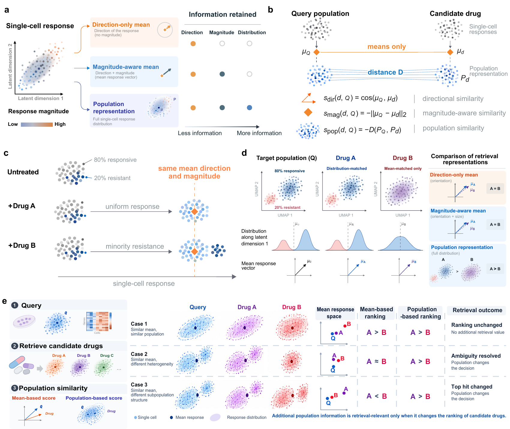

<div align="center">

# PopRetrieve

### Population-response retrieval for single-cell perturbation data

<p>
  
  
  
  <a href="LICENSE"></a>
</p>

<p><strong>A framework for testing when population response structure changes intervention ranking.</strong></p>

<p>
  <a href="#-installation">🚀 Install</a> ·
  <a href="#-data">🤗 Data</a> ·
  <a href="#-reproducing-released-experiments">🧪 Reproduce</a>
</p>

</div>

> This is an anonymized copy of the repository for double-anonymized peer review. Author names, links to the authors' accounts and the manuscript files are withheld.

<p align="center">
  
</p>

## ✨ Overview

PopRetrieve asks when full single-cell response distributions improve drug ranking beyond average responses. This repository provides retrieval metrics, mean baselines, controlled benchmarks and selected experiment drivers for the accompanying manuscript and its Supplementary material.

The central comparison is a representation ladder: direction-only mean cosine, magnitude-aware mean L2 and population-level scores (energy distance, MMD, sliced Wasserstein and subpopulation coverage). The paper separates gains due to response magnitude from gains that require the full cellular response population.

In the manuscript, a magnitude-aware mean recovers most of the apparent gain over directional mean matching. The smaller contribution from cell-to-cell structure weakens under biological and functional evaluation. With observed responses in the target context, population retrieval adds a small gain beyond the magnitude-aware mean. When responses are predicted for a new context, only a Gaussian optimal-transport map among the predictors evaluated in the paper retains that gain. The same held-out protein measurements can favour different RNA rankings depending on whether the evaluator uses mean or population responses.

<table>
  <tr>
    <td align="center" width="33%"><strong>📐 Scoring ladder</strong><br><sub>Direction, magnitude and population-response retrieval.</sub></td>
    <td align="center" width="33%"><strong>🧬 Evaluation ladder</strong><br><sub>Response matching, biological and functional evaluation, then prediction.</sub></td>
    <td align="center" width="33%"><strong>🔁 Reproducibility</strong><br><sub>Fixed configs, scripts and checked output snapshots.</sub></td>
  </tr>
</table>

## 🚀 Installation

```bash
# from the root of the downloaded repository
python -m venv .venv
source .venv/bin/activate
python -m pip install --upgrade pip
python -m pip install -e .
```

The public API is available from `popretrieve.metrics`:

```python
from popretrieve.metrics import score_energy, score_mean_cosine

energy_score = score_energy(candidate_cells, query_cells, max_cells=500, seed=7)
mean_score = score_mean_cosine(candidate_cells, query_cells)
```

Energy and MMD use the unbiased U-statistic by default. Set `POPRETRIEVE_ESTIMATOR=v` only when reproducing explicitly labelled legacy V-statistic outputs.

## 🤗 Data

The processed datasets are hosted on Hugging Face. The dataset link is withheld during double-anonymized review and is available to the editor on the manuscript title page. Download them with Git LFS and point PopRetrieve to the local copy:

```bash
git lfs install
git clone <processed-data repository> popretrieve-data
export DIDR_DATA_ROOT="$PWD/popretrieve-data"
```

The release contains three core processed matrices and their annotation tables. See [`DATA.md`](DATA.md) for dataset details and the additional ZhaoSims2021, Tahoe-100M, GDSC2 and optional CIGS inputs.

## 🧪 Reproducing released experiments

Run commands from the repository root after downloading the required datasets. The scripts write into `results/`; use a separate checkout to preserve the included snapshots.

| Task | Command |
| --- | --- |
| 🧬 Core retrieval experiments | `bash scripts/run_all_core.sh` |
| 📊 Baseline and predict-then-rank experiments (requires optional CIGS inputs) | `bash scripts/run_all_baselines.sh` |
| 🧪 Synthetic HIR-Bench | `bash scripts/run_hir_benchmark.sh` |
| 💊 Dose-mismatch re-identification in SciPlex3 | `python src/experiments/exp18_dose_mismatch.py --data data/processed/sciplex3_all.pt` |
| 📉 Tahoe-100M regression below the mean-cosine ceiling | `python src/experiments/exp19_ceiling_sensitivity.py --per-query results/phase2_transition/bottleneck/bottleneck_per_query.csv --out results/phase2_transition/bottleneck/ceiling_sensitivity.csv` |
| 🎯 Top-ranked candidate in GDSC2 and mechanism-of-action retrieval | `python -I src/experiments/exp20_decision_level.py --gdsc2 results/exp20_decision_level/inputs/gdsc2_candidate_scores.csv --moa results/exp12_partial_observed_retrieval/per_query_scores.csv --out results/exp20_decision_level` |
| 🧮 Tahoe-100M prediction with the Gaussian optimal-transport map and its three covariance controls (GPU) | `python -I src/experiments/phase2_transition/phase_b_loco.py --h5ad <Tahoe-100M plate 3 .h5ad> --freeze-dir results/phase2_transition/eligibility --out results/phase2_transition/covariance_control --predictors ot_map,ot_map_identity,ot_map_shared,ot_map_deranged --device cuda` |
| 🧮 Covariance-control contrasts from that run | `python -I src/experiments/exp21_covariance_control.py --res results/phase2_transition/covariance_control` |

Set `QUICK=1` for reduced smoke runs. Quick outputs are not the manuscript results.

Selected output snapshots and the scope of the released experiments are documented in [`results/README.md`](results/README.md).

## 🗂️ Repository layout

| Path | Contents |
| --- | --- |
| `src/` | Retrieval metrics, baselines, data loaders, benchmarks and experiment drivers |
| `configs/` | Dataset and experiment configurations |
| `scripts/` | Main reproduction entry points |
| `data/` | Location for external datasets |
| `results/` | Checked output snapshots and compact result summaries |

Within `src/`, `popretrieve/` exposes the public API; `retrieval/`, `baselines/`, `benchmarks/`, `data/` and `experiments/` contain the implementations.

## 📚 License

Citation information is withheld during double-anonymized review. PopRetrieve code is released under the MIT License. External datasets retain their original licenses.
